### Computer Science @ University of Calgary · Robotics Software · Builder

I like building systems that move, explain themselves, and make it into the real world.

 

Pick a project in the galaxy to explore its repository ↓

---

  <a href="#-featured-projects">Projects</a> ·
  <a href="#-the-toolbox">Toolbox</a> ·
  <a href="#-what-im-learning">Learning</a> ·
  <a href="#-github-at-a-glance">GitHub stats</a> ·
  <a href="#-say-hello">Contact</a>

## 👋 A little about me

- 🎓 Computer Science student at the **University of Calgary** in Calgary, Alberta.
- 🤖 Software team member with **WayBionic Robotics** and the **Schulich Space Rover Team**.
- 🧰 Technical Lead at **[HVAC Express](https://calgaryhvacexpress.ca)**, where I help maintain the live site and technical infrastructure.
- 🛠️ Engineer Intern at **SYNK**, contributing to brand and technical initiatives for AI-focused products.
- 🔐 Junior Executive, Academic with the **UCalgary Cybersecurity Club**.
- 🎮 I enjoy mixing software with the physical world—from AirPods as a game controller to ROS 2 diagnostics for robots.
- 🚀 I like taking a project from an idea through implementation, testing, documentation, and a working demo.

## 🌌 The repo galaxy

This galaxy maps the projects I keep coming back to: robotics and controls, creative interfaces, local AI experiments, and useful tools. The constellations are clickable in the project list below, too.

🛰️ Robotics, controls &amp; embedded systems

- **[WayBionic ROS 2 Ground Station](https://github.com/Waybionic/waybionic_ground_station)** — Student research platform for remote visibility and control of a surgical robot arm. My work includes ROS 2 diagnostics, motion-test tooling, simulated joint-state workflows, and RViz integration.
- **[Autonomous Obstacle-Avoiding Rover](https://github.com/aj0khi/CS30/tree/main/RoverProejct)** — Java and Phidgets project exploring sonar-based obstacle response, independent motor control, and movement logic.
- **[Schulich Space Rover Team](https://schulich.ucalgary.ca/)** — Collaborating on ROS 2 controls, teleoperation, sensing, and system integration.

🎮 Interactive software &amp; hackathons

- **[Aircade](https://github.com/aj0khi/aircade-mru-hacks)** — A motion-controlled arcade with five games. Uses AirPods head motion, a Swift/Core Motion sender, WebSockets, browser games, and a keyboard fallback.
- **[Proofly — Hack the Change 2026](https://github.com/aj0khi/hack-the-change)** — A team-built prototype for turning community contributions into reviewed, tamper-evident skill evidence.
- **[Personal portfolio](https://github.com/aj0khi/ajmal-portfolio)** — An Astro-powered desktop-inspired portfolio and build log, with interactive project experiences.

🧠 AI, learning &amp; data projects

- **[Teach to Game](https://github.com/aj0khi/teach-to-game)** — A local reinforcement-learning lab where a user defines a game goal and target score; includes self-contained Snake and runner environments.
- **[Inside the Game](https://github.com/aj0khi/soccer-hackathon-project)** — An event-driven foundation for match analytics and explainable, evidence-grounded stories from synthetic football events.
- **[Local AI coding workflow](https://ajmalkhidri.com)** — An experiment in local models, automation, human approval, implementation, and testing.

💻 Coursework &amp; early experiments

- **[CS30](https://github.com/aj0khi/CS30)** — Java coursework, including the rover project and object-oriented exercises.
- **[CS20](https://github.com/aj0khi/CS20)** — Earlier Java coursework and programming exercises.
- **[CPSC 219](https://github.com/aj0khi/cpsc219)** — Python coursework and practice programs.

## 🚀 Featured projects

| Project | What I explored | Stack |
|---|---|---|
| [**WayBionic Ground Station** ↗](https://github.com/Waybionic/waybionic_ground_station) | ROS 2 tools, simulation, motion testing, and robot diagnostics | ROS 2, C++, Python, RViz |
| [**Aircade** ↗](https://github.com/aj0khi/aircade-mru-hacks) | AirPods head motion as a controller for a five-game arcade | Swift, Core Motion, WebSockets, JavaScript |
| [**Proofly** ↗](https://github.com/aj0khi/hack-the-change) | A hackathon prototype for community work and verifiable skill evidence | Node.js, Express, SQLite |
| [**Teach to Game** ↗](https://github.com/aj0khi/teach-to-game) | A local, goal-driven reinforcement-learning practice lab | Python |
| [**Inside the Game** ↗](https://github.com/aj0khi/soccer-hackathon-project) | Explainable match insights from synthetic football events | TypeScript, Next.js, React |
| [**AjmalOS portfolio** ↗](https://github.com/aj0khi/ajmal-portfolio) | An interactive portfolio, project archive, and Three.js explorer | Astro, TypeScript, Three.js |
| [**Obstacle-avoiding rover** ↗](https://github.com/aj0khi/CS30/tree/main/RoverProejct) | Sonar sensing, motor control, and obstacle response | Java, Phidgets |

🧪 More things I've built and explored

- **HVAC Express:** Production website and technical infrastructure for a Calgary heating and cooling company — [visit the site](https://calgaryhvacexpress.ca).
- **Chinook Clean:** A power-washing business I started and operate, spanning customer work and field operations.
- **Robot evidence recorder:** A Python evidence pipeline with a local vault, append-only ledger, and owner portal; exploring a Raspberry Pi prototype.
- **Personal robotics roadmap:** Simulation-first experiments toward imitation learning, reinforcement learning, and navigation.

## 🧰 The toolbox

  

  
  
  
  
  
  

🧩 How I use these tools

- **Robotics:** ROS 2, RViz, Python/C++, Linux, Docker, simulation, diagnostics, and hardware/software integration.
- **Web:** Astro, React, Next.js, TypeScript/JavaScript, HTML/CSS, Node.js, PHP, and WordPress.
- **Experiments:** Swift/Core Motion, Three.js, local LLMs, n8n automation, and Python learning projects.

## 🧭 What I'm learning

- ROS 2 controls, robot simulation, telemetry, and operator-facing diagnostics.
- Full-stack development and reliable, testable application architecture.
- Simulation-first robotics: imitation learning, reinforcement learning, then navigation.
- Local AI workflows with clear human review and useful test coverage.

🗺️ Robotics roadmap

- [x] Build an obstacle-avoiding rover with sonar sensing and motor control.
- [x] Contribute ROS 2 diagnostics and simulated movement tooling to robot projects.
- [ ] Explore imitation learning with the Hugging Face LeRobot SO-101 arm.
- [ ] Try reinforcement-learning locomotion in NVIDIA Isaac Lab.
- [ ] Learn ROS 2 Nav2 and SLAM.
- [ ] Investigate SmolVLA fine-tuning.

## 🏅 Certifications &amp; community

- **Cisco:** Introduction to Cybersecurity.
- **Google:** Introduction to Generative AI; Introduction to Large Language Models; Get started with Google Maps Platform (Web).
- **SkillFront:** ISO/IEC 27001 Information Security Associate.
- **Mount Royal University:** Learning Peer supporting Math 30-1/31 students.
- **TED-Ed Club:** Operations Manager, including website and event responsibilities.
- **Community:** Active volunteer with Ismaili Volunteers.

## 📊 GitHub at a glance

 

 

These cards are generated by community services and can occasionally take a break. Explore my <a href="https://github.com/aj0khi?tab=repositories">repositories</a> for the source of truth.

## 📫 Say hello

Interested in robotics, software, or building something together? [Send me a note](mailto:khidri.ajmal@gmail.com).

  <a href="https://www.linkedin.com/in/ajmal-khidri/">LinkedIn</a> ·
  <a href="https://ajmalkhidri.com">Portfolio</a> ·
  <a href="https://github.com/aj0khi">GitHub</a> ·
  <a href="https://calgaryhvacexpress.ca">HVAC Express</a>

⚡ *Outside of code, I’m probably hiking somewhere in the Canadian Rockies.*

